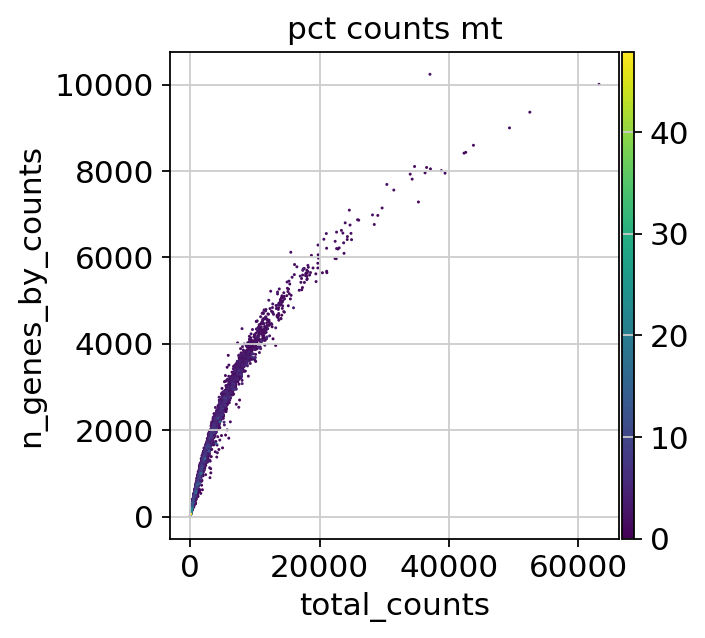
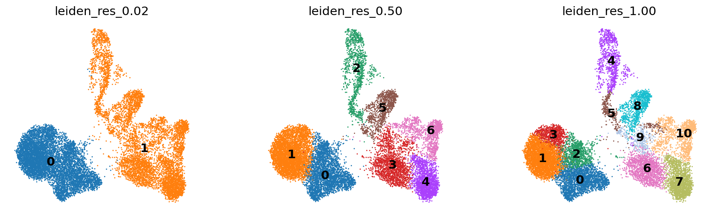
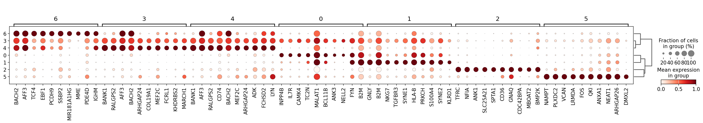
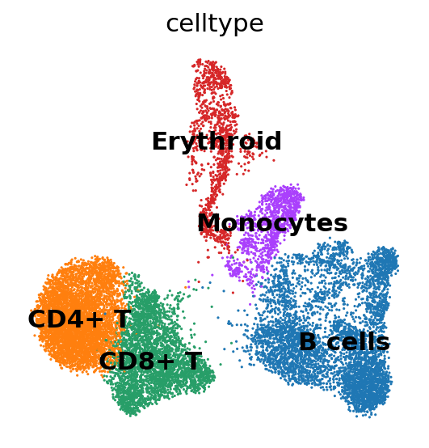

# Basic Single-Cell RNA-seq Analysis with Scanpy

An introductory, annotated workflow for exploring human bone marrow single-cell RNA sequencing data with Python, Scanpy, and AnnData.

**[Open the original notebook](<Basic Single-Cell RNA-seq Analysis with Scanpy (2).ipynb>)** · [Reading guide](docs/NOTEBOOK_GUIDE.md) · [Data access](data/README.md) · [Audit](docs/AUDIT.md) · [Reproducibility](docs/REPRODUCIBILITY.md)

## Overview and motivation

Single-cell RNA-seq measures gene expression in individual captured barcodes, helping researchers investigate heterogeneous tissues. Technical variation, damaged cells, and droplets containing multiple cells can obscure biological patterns. Preprocessing and exploratory analysis help assess these issues before interpreting clusters or assigning cell identities.

I prepared this notebook in Fall 2025 for the Bioinformatics course in the Department of Computer Engineering at Sharif University of Technology. It adapts established educational workflows from **Single-cell Best Practices** and the **Scanpy preprocessing and clustering tutorial**. It demonstrates foundational analysis skills rather than a new analytical method.

**Validation status:** Full-data loading and filtering counts were reproduced. All 36 nonempty code cells passed on a 2,000-barcode subset. The full-data run stopped during Scrublet with exit code 137, and native Jupyter execution was blocked by workspace socket restrictions. See the [validation record](docs/REPRODUCIBILITY.md); a full end-to-end reproduction is not claimed.

## Learning objectives

By working through the notebook, a learner can:

- Explain how AnnData organizes expression measurements and cell/gene metadata.
- Inspect count depth, detected genes, and mitochondrial count fractions.
- Apply the notebook's cell and gene filters and understand their limitations.
- Calculate Scrublet doublet scores and inspect them alongside clusters.
- Normalize counts, select variable genes, and construct a PCA-based neighbor graph.
- Explore UMAP, compare Leiden resolutions, and rank cluster-associated genes.
- Understand why manual cell-type assignments require additional biological validation.

## Dataset description and provenance

| Property | Dataset used here |
| --- | --- |
| Biological material | Bone marrow mononuclear cells from healthy human donors |
| Study | NeurIPS 2021 multimodal single-cell data integration benchmark, Luecken et al. |
| Technology | 10x Multiome Gene Expression and Chromatin Accessibility |
| Selected library | `site4_donor8`, described in the source tutorial as sample 4 of donor 8 |
| Input file | `filtered_feature_bc_matrix.h5`, Figshare file **39546196** |
| RNA matrix at loading | **16,934 barcodes × 36,601 genes** |

The parent study spans multiple donors and sites; this notebook uses **one library**, not the full benchmark. The downloaded file contains gene-expression and chromatin-accessibility features. `sc.read_10x_h5()` uses its default `gex_only=True`, so only gene expression enters this workflow. Rows represent captured barcodes and columns represent genes, not individual transcripts.

Bone marrow offers a useful teaching example because it contains several hematopoietic populations. The file is public, fits a CPU-based introductory analysis, and has a documented upstream tutorial. See [data/README.md](data/README.md) for the exact download route, checksum, and provenance checks.

## Analysis workflow

The following stages are implemented in the notebook, in this order:

| Stage | Code and parameters | What it does |
| --- | --- | --- |
| Load and inspect | `sc.read_10x_h5()`, `var_names_make_unique()` | Load a sparse count matrix and disambiguate duplicate gene symbols. |
| Compute QC metrics | `sc.pp.calculate_qc_metrics(qc_vars=["mt", "ribo", "hb"], percent_top=[20], log1p=True)` | Summarize counts, detected genes, and mitochondrial, ribosomal, and hemoglobin count fractions. |
| Flag QC outliers | Custom `is_outlier()` using SciPy's median absolute deviation (MAD) | Flag values outside median ± 5 MADs for log total counts, log detected genes, or the percentage in the top 20 genes. Flag mitochondrial values outside median ± 3 MADs or above 8%. |
| Filter cells and genes | Exclude either outlier flag; `filter_cells(min_genes=100)`; `filter_genes(min_cells=3)` | Retain cells passing the chosen QC rules and genes detected in at least three retained cells. These cutoffs are dataset-specific teaching choices. |
| Score doublets | `sc.pp.scrublet()` and score-distribution plots | Estimate possible doublets. **The notebook does not remove predicted doublets.** |
| Preserve counts and normalize | Copy `.X` into `.layers["counts"]`; `normalize_total()`; `log1p()` | Retain the filtered counts and rescale each cell to the median library size before applying natural log(1 + x). No explicit CP10k target is used. |
| Select variable genes | `highly_variable_genes(n_top_genes=2000)` | Mark variable genes to emphasize informative variation. The full gene matrix remains available for marker ranking. |
| Reduce dimensionality | `sc.tl.pca()` and PCA plots | Summarize expression variation using the marked variable genes under the tested Scanpy defaults. There is no explicit `sc.pp.scale()` step. |
| Build a graph and embed | `sc.pp.neighbors()`; `sc.tl.umap()` | Connect similar cells in PCA space and visualize the graph in two dimensions. |
| Cluster and reassess QC | `sc.tl.leiden(flavor="igraph", n_iterations=2)`; additional resolutions 0.02, 0.5, 1.0 | Compare graph communities and inspect doublet scores and QC metrics on UMAP. |
| Rank markers | `rank_genes_groups(groupby="leiden_res_0.50", method="wilcoxon")` | Rank genes associated with each cluster against the remaining cells; display a top-10 dotplot and inspect cluster 2. |
| Add provisional labels | A handwritten cluster-to-name dictionary | Illustrate manual annotation using marker inspection and external Enrichr screenshots. Enrichr is not called programmatically. |

AnnData stores the normalized, log-transformed matrix in `.X`, filtered counts in `.layers["counts"]`, cell metadata in `.obs`, gene metadata in `.var`, PCA/UMAP coordinates in `.obsm`, and graph matrices in `.obsp`. The notebook does not write an `.h5ad` result to disk.

## Key results and visualizations

These numbers and figures come from the **original saved notebook outputs**. They are retained as the historical teaching example, not replaced with a new analysis.

| Checkpoint | Cells/barcodes | Genes |
| --- | ---: | ---: |
| Loaded RNA matrix | 16,934 | 36,601 |
| After MAD and mitochondrial filtering | 14,814 | 36,601 |
| After minimum-gene and minimum-cell filters | 14,813 | 28,471 |

### Inspect quality before filtering



Each dot is a barcode. Examining these measurements together helps distinguish obvious QC outliers from biological differences; a single threshold cannot establish cell quality with certainty.

### Compare clustering resolutions



The saved panels contain **2, 7, and 11 clusters**, respectively. Increasing resolution divides the graph more finely; it does not establish a correct number of cell types. UMAP axes and distances between disconnected groups should not be treated as quantitative biological measurements.

### Inspect cluster-associated genes



Dot size summarizes the fraction of cells expressing a gene, while color shows gene-wise rescaled mean expression because `standard_scale="var"`. This is not a fold-change plot. In the saved cluster-2 table, the top genes include **TFRC, NFIA, ANK1, SLC25A21, and SPTA1**. Such evidence supports forming an annotation hypothesis, not declaring a validated identity.

### Explore a manual annotation example



The notebook maps clusters 0–6 to CD8+ T, CD4+ T, erythroid, B cells, B cells, monocytes, and B cells. These are the author's **provisional teaching labels**, with no independent reference-label evaluation. Cluster numbers can change between runs, so the dictionary must be checked again before interpreting a new run.

See [figures/README.md](figures/README.md) for the exact original cell/output locations and image checksums.

## Installation and requirements

Use **Python 3.12** for the documented validation environment. The original notebook metadata records Python 3.10.19 and a local kernel named `xenium`; its original package versions were not saved. The new pinned environment is a separate compatibility baseline, not a reconstruction of that historical environment.

```bash
git clone https://github.com/aynemoon/Basic-Single-Cell-RNA-seq-Analysis-with-Scanpy.git
cd Basic-Single-Cell-RNA-seq-Analysis-with-Scanpy
python -m venv .venv
```

Activate the environment:

```bash
# Linux / macOS
source .venv/bin/activate
```

```powershell
# Windows PowerShell
.venv\Scripts\Activate.ps1
```

Then install and register a notebook kernel:

```bash
python -m pip install -r requirements.txt
python -m ipykernel install --user --name scanpy-intro --display-name "Scanpy intro"
```

The requirement file pins the directly used packages and constrains their dependencies to the [validation environment snapshot](docs/environment-freeze.txt). No GPU, R installation, PyTorch, scvi-tools, or PyDESeq2 is required for the implemented workflow.

## Step-by-step execution instructions

1. Complete installation above and download the input into the **repository root** using the instructions in [data/README.md](data/README.md). Despite that documentation folder's name, the existing notebook expects its HDF5 file beside the notebook.
2. Run `python -m jupyterlab` from the repository root.
3. Open **Basic Single-Cell RNA-seq Analysis with Scanpy (2).ipynb** and select the **Scanpy intro** kernel instead of the historical `xenium` kernel.
4. Use **Restart Kernel and Run All Cells**. Read the [companion guide](docs/NOTEBOOK_GUIDE.md) alongside the original explanations.
5. Check the loaded shape, filtering counts, QC plots, clustering solutions, and marker tables. Review markers before reusing the manual labels.
6. Save a **separate copy** if you want to preserve your rerun outputs. The source notebook already contains historical outputs, so opening it is not evidence that you have run it.

Figures and tables are displayed inline; no processed dataset or standalone figures are automatically saved. [scripts/scanpy_intro.py](scripts/scanpy_intro.py) exposes the same code cells for searching and reading. The notebook remains the primary teaching interface.

The input download is about **163 MiB**. Memory and runtime measurements, execution evidence, and any limitations are recorded in [docs/REPRODUCIBILITY.md](docs/REPRODUCIBILITY.md). A CPU is sufficient; allow extra disk space for the environment, data, and local results.

## Biological interpretation and limitations

- This is an exploratory analysis of one library. It does not compare conditions or support population-level inference across donors.
- QC thresholds can remove genuine cell populations. The mitochondrial fraction measures counts assigned to mitochondrial genes, not a direct assay of viability.
- Scrublet flags remain in the analyzed data. Ambient RNA correction and batch integration are not implemented.
- Cell-level Wilcoxon rankings are exploratory cluster markers. Small p-values are not evidence of replicated biological effects; a bulk differential-expression package alone cannot solve missing donor replication.
- Manual labels and cluster numbering need review. No automated annotation, held-out label evaluation, or validated cell-type reference is included.
- Package defaults and numerical libraries can affect embeddings, clustering, and marker order. A successful execution is distinct from reproducing every original numerical result.

## References and credits

This notebook combines and adapts material from the following educational resources. Credit for the underlying methods, tutorial code, and adapted explanations belongs to their respective authors.

- [Single-cell Best Practices: Quality Control](https://www.sc-best-practices.org/preprocessing-visualization/quality-control/), especially the example dataset, MAD-based QC function, and filtering approach. See also the [book repository](https://github.com/theislab/single-cell-best-practices) and Heumos et al., [Best practices for single-cell analysis across modalities](https://doi.org/10.1038/s41576-023-00586-w).
- [Scanpy: Preprocessing and clustering](https://scanpy.readthedocs.io/en/stable/tutorials/basics/clustering.html), especially normalization, feature selection, graph analysis, clustering, QC reassessment, and marker-ranking examples. The current upstream tutorial uses different samples; this repository retains its original `site4_donor8` input.
- Luecken et al. (2021), [A sandbox for prediction and integration of DNA, RNA, and proteins in single cells](https://openreview.net/forum?id=gN35BGa1Rt), the original study/benchmark cited by the notebook.
- Wolf, Angerer and Theis (2018), [SCANPY: large-scale single-cell gene expression data analysis](https://doi.org/10.1186/s13059-017-1382-0).
- [AnnData documentation](https://anndata.readthedocs.io/) and the [AnnData manuscript cited in the notebook](https://doi.org/10.1101/2021.12.16.473007).
- Wolock, Lopez and Klein (2019), [Scrublet](https://doi.org/10.1016/j.cels.2018.11.005); Traag, Waltman and van Eck (2019), [Leiden clustering](https://doi.org/10.1038/s41598-019-41695-z); McInnes, Healy and Melville (2018), [UMAP](https://arxiv.org/abs/1802.03426).
- [Enrichr](https://maayanlab.cloud/Enrichr/), shown in the notebook's manual interpretation screenshots.

The original notebook also embeds introductory diagrams whose individual image sources and reuse terms are not fully recorded. They have not been extracted into the README. This documentation update does not introduce a blanket license for third-party material; see the [attribution audit](docs/AUDIT.md).

## Author information

**Aysan Neghabi** · [@aynemoon](https://github.com/aynemoon)

Educational adaptation and presentation prepared for the Fall 2025 Bioinformatics course at Sharif University of Technology. This repository demonstrates introductory Scanpy and computational biology practice. Questions and suggestions are welcome through [GitHub issues](https://github.com/aynemoon/Basic-Single-Cell-RNA-seq-Analysis-with-Scanpy/issues).
